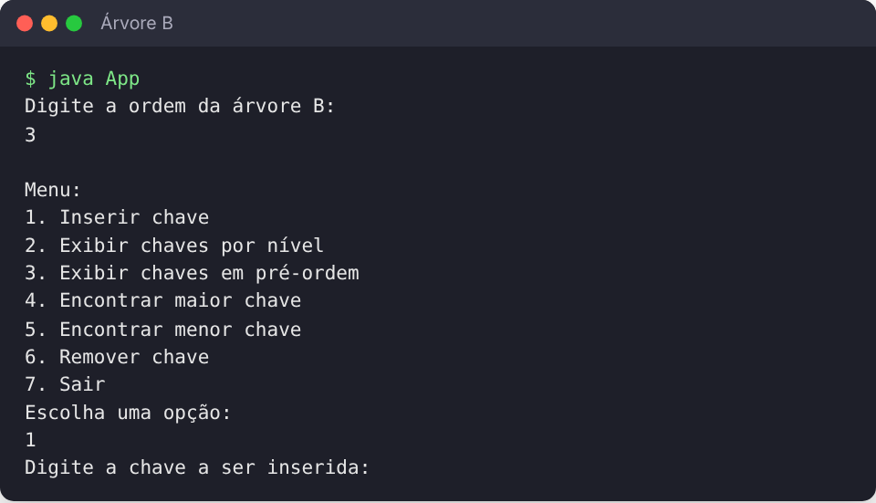

# Árvore B em Java

Implementação de uma **árvore B** de ordem configurável em Java, feita para a disciplina de **Estruturas de Dados**. O programa tem um menu no terminal para inserir chaves e percorrer a árvore.



## Funcionalidades

- Criação da árvore com **ordem definida pelo usuário**
- **Inserção** de chaves com divisão (*split*) de nós cheios e promoção da chave do meio
- Exibição das chaves **por nível** e em **pré-ordem**
- Busca da **maior** e da **menor** chave
- Remoção: opção presente no menu, ainda não implementada

## Estrutura

| Arquivo | Responsabilidade |
|---|---|
| `src/NodeB.java` | Nó da árvore: vetor de chaves, vetor de filhos e contagem de chaves |
| `src/ArvoreB.java` | Inserção, divisão de nós, percursos e busca de mínimo e máximo |
| `src/Retorno.java` | Estrutura auxiliar de retorno (nó + posição da chave) |
| `src/App.java` | Menu interativo |

## Como executar

```bash
cd src
javac *.java
java App
```

Uma sequência boa para testar: `10, 20, 50, 80, 30, 40, 70, 60, 90, 200, 150, 130, 120`.

## Tecnologias

Java

---

Feito por [João Pedro Pimenta](https://www.linkedin.com/in/joao-pedro-pimenta/) durante a graduação em Ciência da Computação na UNICAP.
